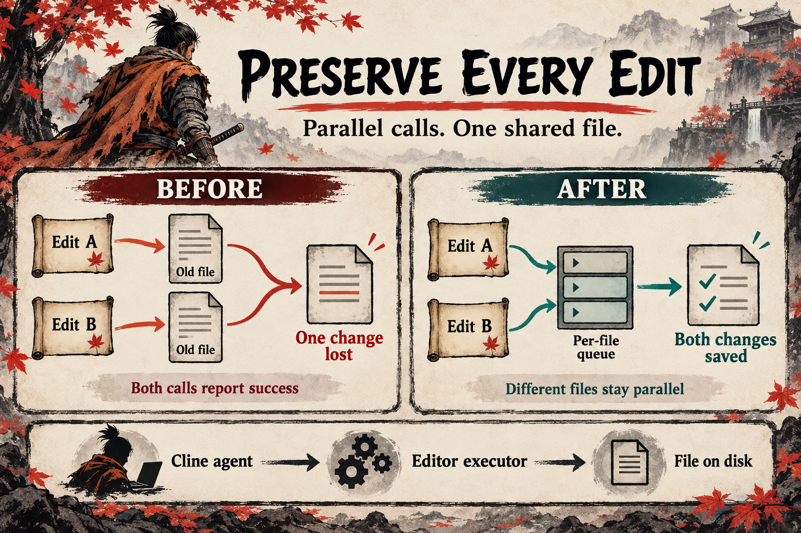

# Preserve every edit

Cline sends edit requests to a file editor, which reads a file, changes the requested text, and saves the file. Two requests can read the same original content and each save a different result. The later save loses the other change even though both calls report success.

The correction gives each file an ordered queue shared by editor instances in the process. Each operation reads the result of the previous operation. Different files can still change in parallel.

Issue: https://github.com/cline/cline/issues/15417

The image was generated with the native image generation tool. The theme is inspired by Sekiro. Its illustration explains the mechanism and is not test evidence. The exact prompt is in `../image-prompts.json`.
