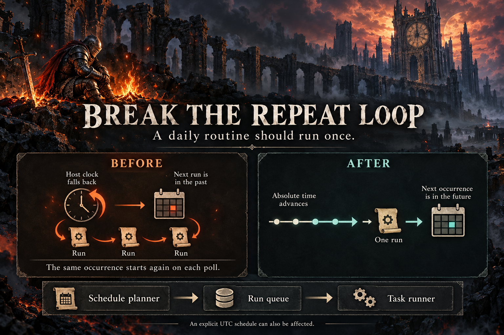

# Break the repeat loop

Cline calculates the next time for a routine, puts a due run in a queue, and starts a task. During the repeated daylight-saving hour, a local clock operation can move the calculated timestamp backward. The queue then considers the same routine overdue again on each poll.

The correction advances along absolute time and matches the intended calendar time afterward. The next occurrence must be later than the supplied timestamp. An explicit UTC schedule also needs this protection because the original rounding used the computer's local clock.

Issue: https://github.com/cline/cline/issues/15418

The image was generated with the native image generation tool. The theme is inspired by Dark Souls. Its illustration explains the mechanism and is not test evidence. The exact prompt is in `../../image-prompts.json`.
